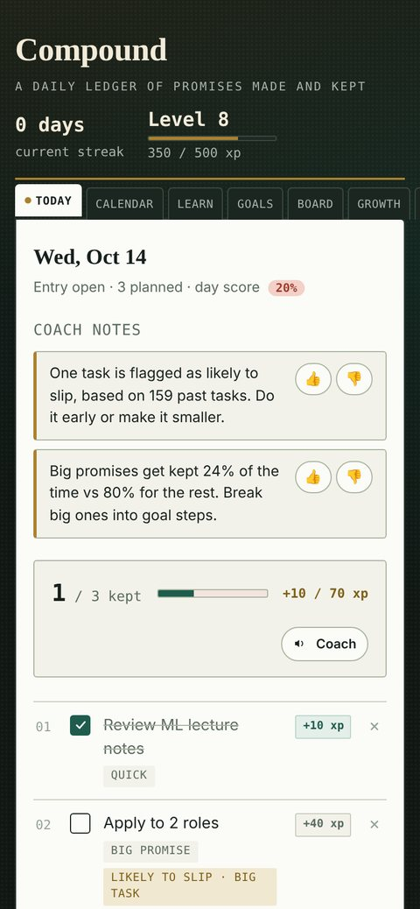
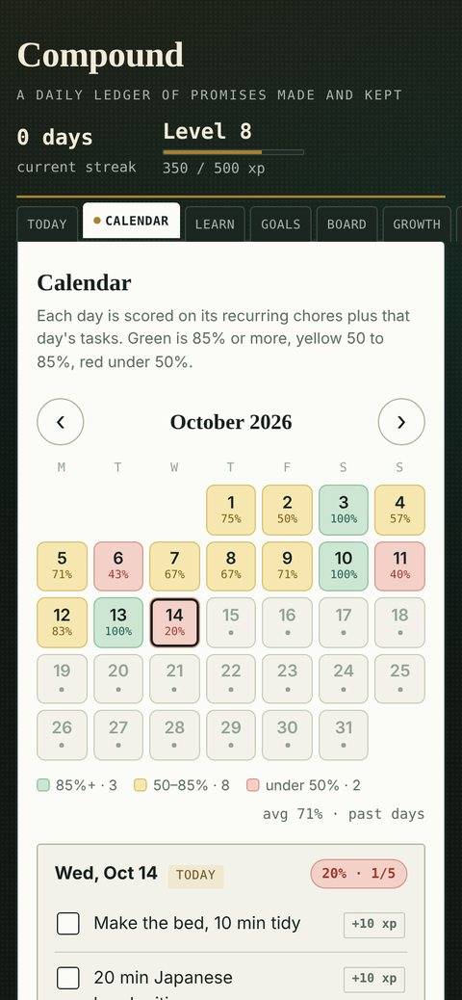
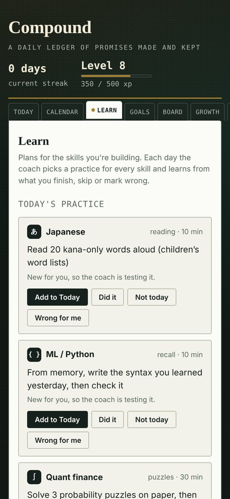
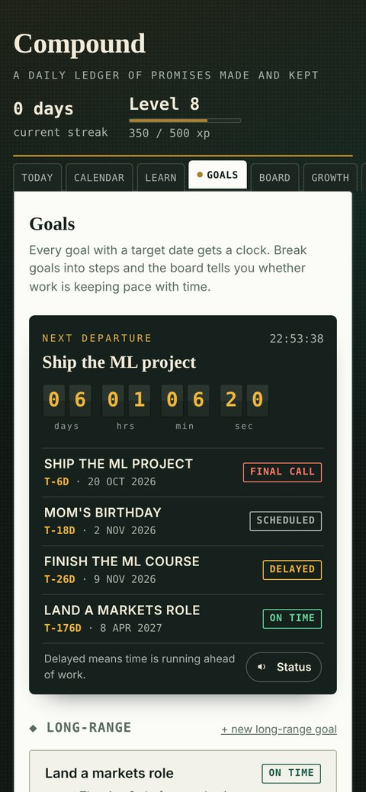

<p align="center">
  
</p>

<h1 align="center">Compound</h1>

<p align="center">A daily ledger of promises made and kept. Small days, compounded.</p>

<p align="center">
  <a href="https://justasudonoob.github.io/Compound/"><b>Open the app →</b></a>
  &nbsp;·&nbsp; works offline &nbsp;·&nbsp; iPhone, iPad, Android, Windows, Mac &nbsp;·&nbsp; free, no account
</p>

<p align="center">
  
  
  
  
</p>

## What it does

| Tab | What you do there |
|---|---|
| **Today** | Write the day's tasks, tick them off for XP, close out the day. Shows today's chores, suggested practice and coach notes. |
| **Calendar** | Set recurring chores (every day, chosen weekdays, or N times a week or month). Each day turns green (85%+), yellow (50 to 85%) or red (under 50%). |
| **Learn** | Level-by-level plans for Japanese, ML / Python, quant finance and fitness, or any skill you plan with AI. One practice a day per skill, plus spaced reviews. |
| **Goals** | Long and short-term goals on a departures board, with steps and an on-time or delayed status. |
| **Board** | Sticky-note promises to people. Peel one off when it's kept. |
| **Growth** | Your compound balance: a kept day adds 1%, an empty day takes 1% away. |
| **Log, History** | A permanent record of every day. |

A voice coach (female or male) speaks at key moments and works offline.

## The coach learns from you

All of this runs on your device, with no internet needed:

- It tries different practice types for each skill and learns which ones you actually finish. Tap **Wrong for me** and it drops that practice for a week.
- After about 20 past tasks, it flags tasks you are likely to miss, with the reason.
- After about 10 logged days, it points out patterns such as your weakest weekday. Every note has 👍 and 👎, and 👎 hides that note for three weeks.

## AI planning and chat (optional, free options)

| Way | Cost | Setup |
|---|---|---|
| Copy and paste | Free | None. Tap **Copy**, paste into Claude, ChatGPT or Gemini, then paste the answer back. |
| Gemini key | Free tier, daily limits | Get a key at [aistudio.google.com](https://aistudio.google.com) (Get API key), then paste it in Learn → AI settings. |
| Claude key | Paid per use | Key from [console.anthropic.com](https://console.anthropic.com), pasted in AI settings. |

Keys stay on your device and are never included in exports or backups. On Google's free tier, what you send may be used to improve Google's products, so keep private details out.

## Install

**iPhone or iPad:** open the link in Safari, tap Share, then **Add to Home Screen**.
**Android:** open the link in Chrome, tap ⋮, then **Install app**.
**Windows or Mac:** open the link in Chrome, Edge or Brave, then click the install icon in the address bar.

## Updates and your data

Your data lives only on your device, in the browser's storage for this site. Nothing is uploaded.

- **Updating:** close the app fully and open it again. The footer shows the version (for example `v6.2 · 14 Oct`). You never need to delete the app or clear website data to update.
- **Updates never delete data.** Before the first launch of each new version, Compound saves a full copy of your ledger on the device. It also saves one copy a day. To see or restore them, open **backups** in the footer. A restore saves the current state first, so it can be undone, and so can **reset all**.
- **Keep an export file.** Device backups disappear if you delete the home-screen app or clear website data. Tap **export data** every week or two and keep the file somewhere safe (Files, Drive, email to yourself). To bring it back, use **import data**. Import adds to what is already there and does not overwrite it.
- **Moving devices:** export on the old device and import on the new one. Each device keeps its own copy.

## For developers

It is a single-file PWA: `index.html` holds the app, `library.js` holds the built-in skill plans, and `service-worker.js` handles offline use (pages load from the network first, everything else from the cache). GitHub Pages deploys from `main`.

```bash
npm install
npm test
```

The tests run the app in jsdom. `tests/upgrade.test.js` loads ledgers saved by older versions (v5 and v6.1) into the current build and fails if any saved key or value is lost, if the pre-update backup is not an exact copy, or if a restore does not bring the data back. GitHub Actions runs these tests on every push.

Rules for changes that touch stored data:

1. Never delete or rename a stored key or field. Add new keys and fill defaults on load.
2. If stored data must change shape, raise `DATA_VERSION` and add a step to `MIGRATIONS` that keeps the old fields readable.
3. Bump `APP_VERSION`, the footer label and `CACHE_NAME` in `service-worker.js` on every release.
4. Add the old shape to `tests/upgrade.test.js` and run `npm test` before pushing.
